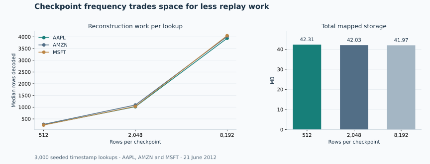

# Nasdaq book replay

Store ten-level LOBSTER depth snapshots as checkpoints and sparse updates, then seek to a timestamp without loading the original CSVs.

The replay matched **all 1,338,904 snapshots** across AAPL, AMZN and MSFT from 21 June 2012. The mapped files occupy **42.0 MB**, compared with **224.9 MB** for dense depth and timestamp arrays, an **81.3% reduction**.



## Run

Use Python 3.12 and run commands from the repository root:

```sh
python -m venv .venv
source .venv/bin/activate
python -m pip install -r requirements.txt
python -m unittest discover -s lob -v
python -m lob.fetch
python -m lob.run
python -m lob.compare
```

The fetcher downloads the three official ten-level samples and checks their SHA-256 values. The raw ZIPs and generated `.lob` archives stay out of git. Saved verification results and benchmarks are included.

Inspect an archive after `lob.run`:

```sh
python -m lob.cli results/AAPL.lob seek 34200000000000000
python -m lob.cli results/AAPL.lob replay 2046 2051
```

The seek timestamp is an integer number of picoseconds since midnight. The example seeks to 09:30:00. Use `--before` to exclude updates at the exact timestamp. Before the first snapshot, a seek returns `null`.

## Format

Each book row contains 40 `int32` fields: ask price, ask size, bid price and bid size at each of ten levels. Timestamps use `int64`. The archive stores:

- A full snapshot every 2,048 rows.
- Changed column indices as `uint8` and their deltas as `int32`.
- A `uint32` pointer array locating the updates for each row.
- A small header describing array shapes and types.

`open_mapped` exposes read-only NumPy memory maps. A binary search finds the last source row at or before the requested time, including the final row when timestamps tie. Replay starts at the preceding checkpoint and applies updates through that row. Some source timestamps have 12 fractional digits, which are preserved exactly.

## Verification and trade-off

| Symbol | Snapshots | Dense MB | Mapped MB | Mismatches |
|---|---:|---:|---:|---:|
| AAPL | 400,391 | 67.3 | 19.8 | 0 |
| AMZN | 269,748 | 45.3 | 10.5 | 0 |
| MSFT | 668,765 | 112.4 | 11.8 | 0 |
| Total | 1,338,904 | 224.9 | 42.0 | 0 |

MB means 1,000,000 bytes. The dense comparison includes depth and timestamp arrays. Mapped sizes include array data and headers; this comparison is not against compressed source ZIPs.

The benchmark compares checkpoints every 512, 2,048 and 8,192 rows with 1,000 seeded timestamp queries per symbol. Moving from 8,192 to 512 rows cuts the median rows decoded by about 94%, with about 0.8% more storage. Warm timings are saved too and depend on the machine. Decoded rows measure the amount of reconstruction work.

`lob.run` compares every decoded checkpoint block with its source and independently checks the streamed depth checksum. Unit tests cover tied timestamps, checkpoint boundaries, unchanged books, damaged files and future updates.

## Files and sources

- `lob/replay.py`: source parsing, checkpoint encoding and reconstruction.
- `lob/mapped.py`: atomic archive writer and memory-map reader.
- `lob/run.py`: full snapshot verification and storage totals.
- `lob/compare.py`: checkpoint sweep.
- `lob/cli.py`: timestamp lookup and row-range replay.
- `results/metrics.json`, `results/checkpoint_sweep.json`: saved measurements.

Data: [official LOBSTER samples](https://php.lobsterdata.com/info/DataSamples.php) and [file structure](https://php.lobsterdata.com/info/DataStructure.php). The inputs are published Nasdaq book snapshots. The code reconstructs those snapshots from stored deltas; it does not reconstruct a book from raw exchange messages.


To redraw the saved figure, install `requirements-plots.txt` and run `python -m lob.plot`.
